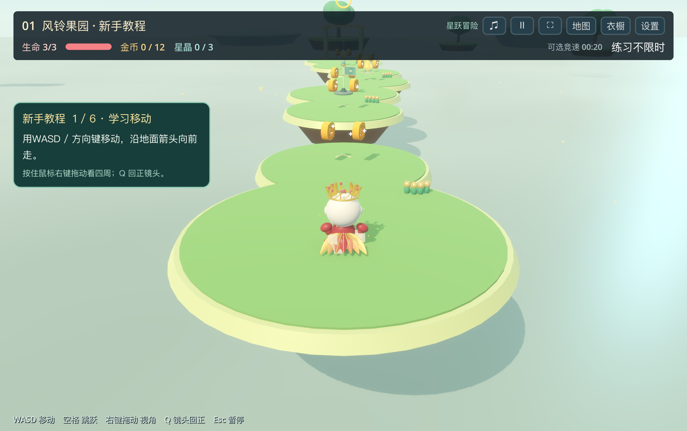
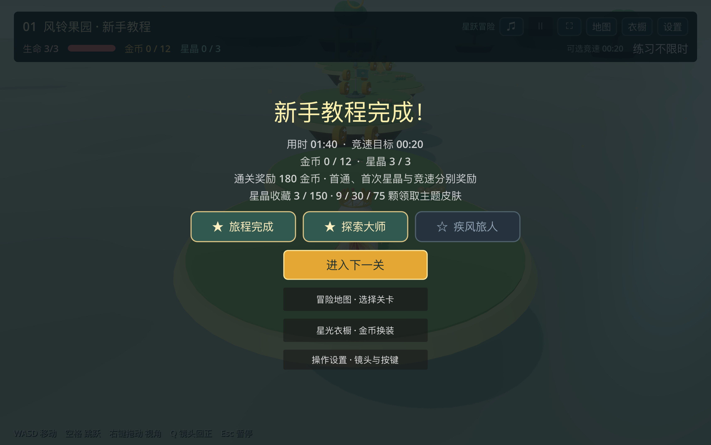
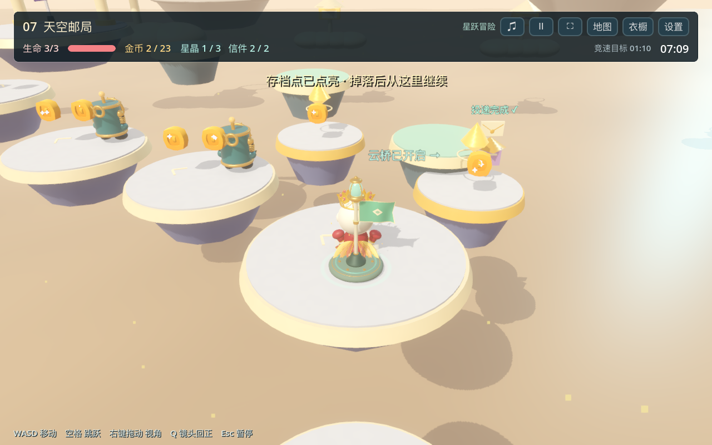
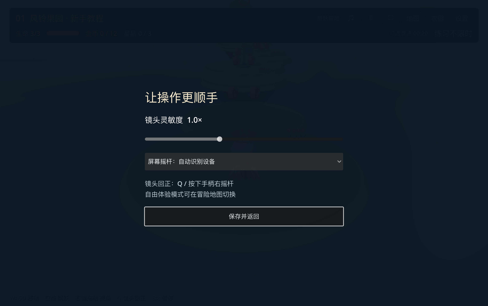

# 星跃岛 · 探索与投递升级

本轮落实代表关玩法、独立奖章、长关节奏、场景层次、镜头与输入适配、正式冒险和自由体验分离。改动前的代码备份位于 `.backups/experience-upgrade/`；玩家旧存档文件保留。

## 可以直接体验的变化

- 第七关天空邮局：在起点领取两封信，在晨光与暮云邮亭投递；送齐后，检查点旁的三座薄荷浮台成为可通行云桥，绕开最后一座升降台。掉落保留投递进度，整关重试重置。两封信未送齐时终点提示缺少投递。
- 通关、收齐星晶、达成竞速目标分别授予奖章。路线长度和移动／喷火机关的等待预算决定每关竞速目标。该目标是初始设计值，尚未经过大量真人成绩标定。
- 每次通关 30–50 金币，首通额外 75，首次增加的每颗星晶 25，首次竞速奖章 35。9／30／75 颗累计星晶在结算时赠送三款现有主题皮肤，不改变角色能力。
- 长关安全平台增设检查点，回头收集时不倒退复活位置。第 14／24／34／44 关加入宽平台和较慢机关作为节奏缓冲。
- 两行信息栏减少横向拥挤，钱包集中在衣橱展示；菜单提供操作设置。键鼠默认隐藏屏幕摇杆，触屏自动显示，也可手动选择。Q／手柄右摇杆按下回正，右摇杆与触屏右侧拖动控制镜头。
- 镜头使用带体积的障碍检测、离开障碍后的平滑拉远和跳跃高度缓动。空中光圈标示角色正下方可落脚表面，不预测未来跳跃轨迹。
- 每个世界突出一座主地标，增加低对比度远景岛屿；地标布局保留平台和完整镜头环绕空间。
- 冒险地图切换模式：正式冒险保存关卡、奖章、金币与皮肤；自由体验开放全关卡和无限金币，退出该模式恢复正式冒险钱包、穿戴和所在关卡。

## 实际渲染

## 验证范围

- 50 关完整流程：开场、暂停、选关、重试、钥匙／邮局任务锁、通关、解锁和记录读取。
- 全部主路及星晶支线的基础跳跃，加邮局云桥四段跳跃。移动平台在检查时固定或从顶部出发，隔离敌人与伤害机关；这不是完整真人战斗通关。
- 实际碰撞取信与投递、云桥解锁／重试重置、检查点前后顺序、慢速全收集奖励、首通与竞速去重、写入失败回滚及重试、自由模式隔离和旧进度迁移。
- 人物控制、机关互动、衣橱钱包回归；地标间距与镜头视线检查覆盖全部 50 关。
- 界面实际渲染检查包含开场、游戏、设置、地图、结算、邮亭、云桥与落点提示；检查 1280×720、1024×768、900×720 下的信息栏边界。

手柄与触屏控制已接入，但本轮没有连接实体手柄或移动设备验证。音乐盒节拍关、时空切换关属于后续可独立制作的关卡机制，本轮代表关集中重做天空邮局。
