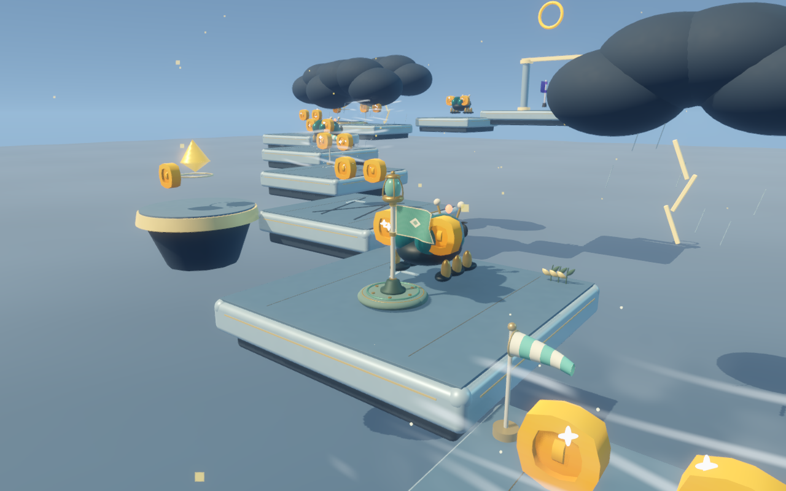
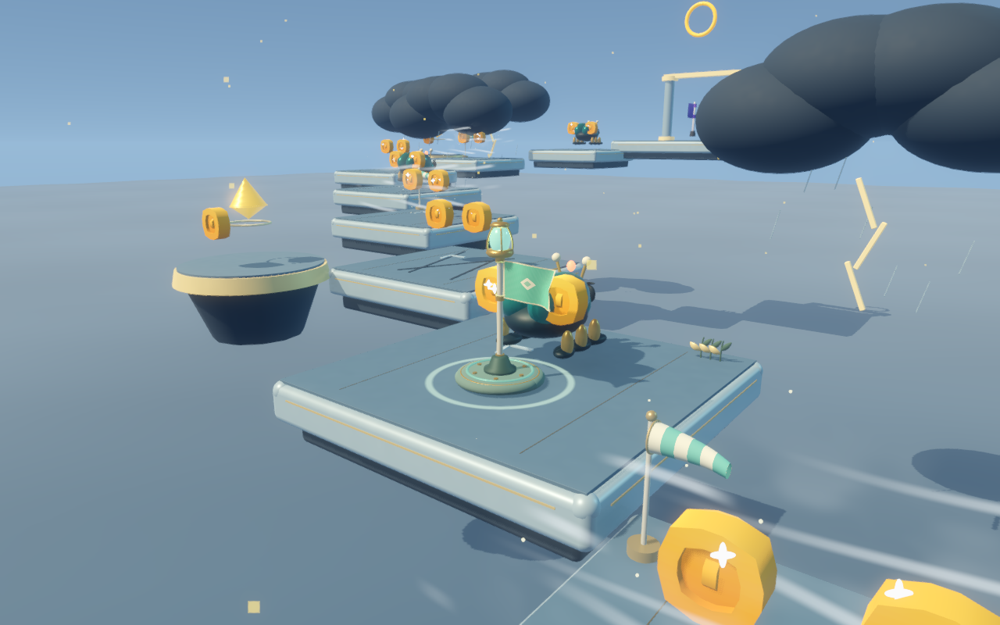
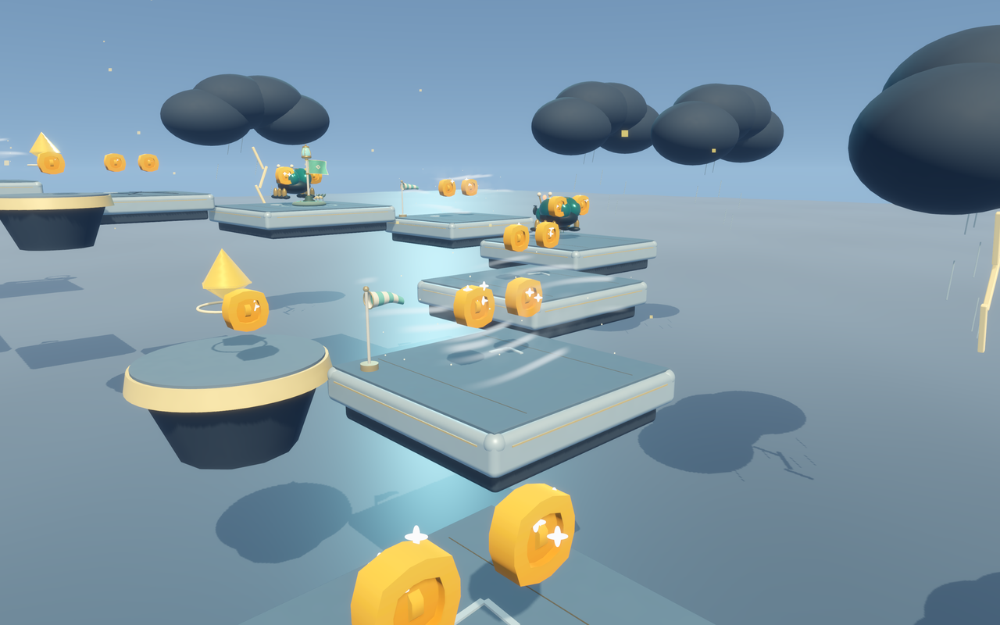
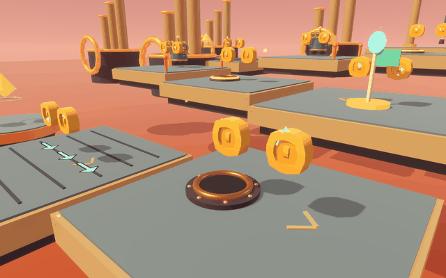

# 喷口与后续关卡模型精修 · 2026-09-25

第六关橙色喷口改成持续翻动、向上消散的火焰；本轮又把存档点和风场改成同一套“分层曲面 + 动态材质 + 少量粒子/柔光”的效果语言。第七至第五十关继续使用细化后的平台边缘、材质和场景模型，保留奶油色、圆润可爱的风格。

## 存档点

- 旧旗杆替换为有真实支撑关系的圆角底座、嵌入式金属底环、立柱套环、顶部晶体灯和四向护架。
- 旗面使用细分布料曲面，会随时间轻微起伏；布边、旗角和金属绑带彼此连接，避免悬空的平面贴片。
- 激活后晶体亮起，底座出现扩散光环，灯光和旗面颜色渐进变化；存档触发、复活位置和碰撞范围保持不变。





## 第十一关风场

- 风场不再是静态横条，改为沿实际推力方向移动的多层半透明气流带。
- 气流带有不同相位的边缘摆动、较淡的体积雾面、连续漂移尘粒和局部青绿色柔光；平台旁增加会随阵风摆动的布质风向袋。
- 气流视觉时间与原来的风力模拟共用时钟，推力方向和强度保持原参数，暂停时效果也会停住。



## 喷口

- 原来的橙色实体球团替换为三层交叉火焰曲面，呈现橙红外焰、明亮内焰和不断变化的火舌。
- 加入上升火星、很淡的烟雾和局部暖光；停止喷发后留有短暂淡烟。喷口增加铜质口沿、深色开口及铆钉。
- 首轮实拍火焰过曝，已降低发光强度并改用透明混合；最终火焰轮廓和内外颜色更清楚。
- 保留原先的预警、喷发周期、后续关卡加速参数及伤害范围。视觉时间跟随机关时间，游戏暂停时一起暂停。其他关卡已有的同类喷口也使用新效果。



[六个阶段近景](world-polish/vent-cycle.png)

## 第七至第五十关

- 平台和建筑方块增加圆角，较大的球面、圆柱更平滑；水晶等有意保留棱面的形状继续保留。
- 平台增加下沿镶边；木质主题增加细板缝，机械主题增加小型固定件。材质有轻微木纹、拉丝或细颗粒变化，避免盖过原配色。
- 平台边缘按主题区分为叶片、水晶和机械标记。
- 部分地标补充专属结构：天空邮局信封标识及屋檐、竹庭灯笼骨架、钟楼刻度与窗框、风车与糖果屋等圆窗、火车圆筒锅炉与箍带。
- 首轮实拍拉丝线条偏明显，最终降低了对比。没有新增落脚障碍或更改碰撞体。

这是共用模型细化与部分主题地标的专项改进，未把全部关卡重新设计成另一套场景。

## 实拍与检查

通过 Godot 图形渲染生成第六至第五十关共 90 张全景/地标近景、6 张喷口阶段图以及 96 张原始喷口动画帧；GIF 预览压缩为 82 帧。已查看全部十张关卡比较板，并检查喷口和代表地标的放大图。拼图与 GIF 只由实际渲染合成，未重画场景。

| 关卡 | 路线全景 | 主题地标 |
| --- | --- | --- |
| 06–14 | [全景 1](world-polish/level-board-1.png) | [地标 1](world-polish/landmark-board-1.png) |
| 15–23 | [全景 2](world-polish/level-board-2.png) | [地标 2](world-polish/landmark-board-2.png) |
| 24–32 | [全景 3](world-polish/level-board-3.png) | [地标 3](world-polish/landmark-board-3.png) |
| 33–41 | [全景 4](world-polish/level-board-4.png) | [地标 4](world-polish/landmark-board-4.png) |
| 42–50 | [全景 5](world-polish/level-board-5.png) | [地标 5](world-polish/landmark-board-5.png) |

检查结果：

- `world_visual_check.gd`：第六至第五十关的平台结构、碰撞高度、喷火伤害范围/时序、火星变换及局部光状态，另检查了存档点模型和风场层次效果，0 失败。本次最大场景网格数 1372；这不是帧率测试。
- 本轮实拍另外检查了第十一关存档点冷态/激活态和风场四个时间点；存档点模型、布旗、光环、风向袋和气流层均来自 Godot 实时渲染。
- `world_design_check.gd`：50 关目录、路线与难度参数，0 失败。
- `mechanics_check.gd`：检查点、坍塌、弹簧、传送带、喷火、升降台、风场与踩敌，0 失败。
- 最终图形渲染日志无脚本或着色器错误。

关卡数、路线、金币、20 款皮肤 ID/价格、购买记录和操控保持原有设置。本轮检查与拍摄均关闭关卡记录及钱包写入，不改用户存档。未启动后台自动任务或子代理。

## 复现

```sh
godot --headless --path . --max-fps 60 --script tests/world_visual_check.gd
godot --headless --path . --script tests/world_design_check.gd
godot --headless --path . --max-fps 60 --script tests/mechanics_check.gd
godot --path . --max-fps 60 --script tools/render_world_polish.gd -- --clip
python3 tools/design/build_world_polish_boards.py
```

实拍工具需图形窗口；最后一条需要 Pillow。`--only=6,7,9` 可限定拍摄关卡。
